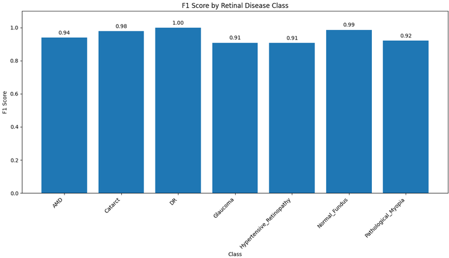

# Retinal Fundus Image Classifier
### A deep learning-based retinal fundus image classification system that uses ResNet18 to classify retinal images into seven different disease categories. The project provides an interactive Streamlit web application where users can upload a retinal image and receive a predicted disease along with the model's confidence score.

## Tech Stack
- Python
- Pytorch
- Torchvision
- ResNet18
- Streamlit
- Pillow
- Numpy

## Features
- ResNet18-Based Classification — Uses a deep learning model based on ResNet18.
- 7-Class Disease Detection — Classifies retinal images into seven categories (AMD — Age-related Macular Degeneration, Cataract, DR — Diabetic Retinopathy, Glaucoma, Hypertensive Retinopathy ,Normal Fundus, Pathological Myopia)
- Image Upload — Supports JPG, JPEG, and PNG fundus images.
- Real-Time Inference — Generates predictions from uploaded images.
- Confidence Score — Displays the model's confidence for the predicted class.
- Image Preview — Displays the uploaded retinal image before classification.
- Interactive Streamlit Dashboard — Simple browser-based interface.

## Screenshots
### Dashboard

### Confusion Matrix

### F1 Score distribution

## Future Improvements
- Add heat map to add explainability
- Add more interactive UI

## Dataset
https://www.kaggle.com/datasets/gautamrajiitk/retinal-fundus-image-50k