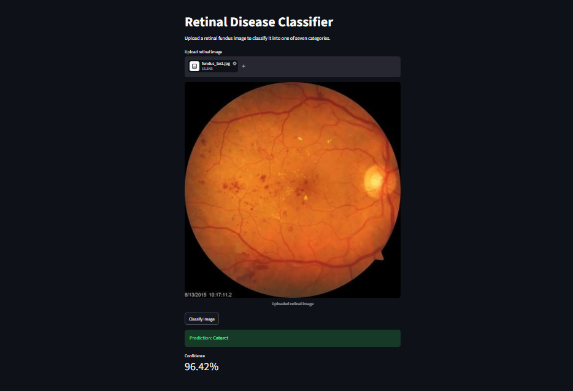
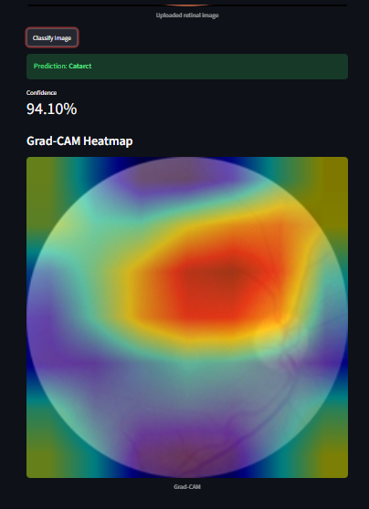
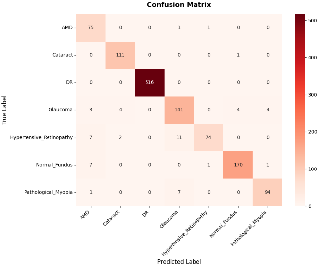
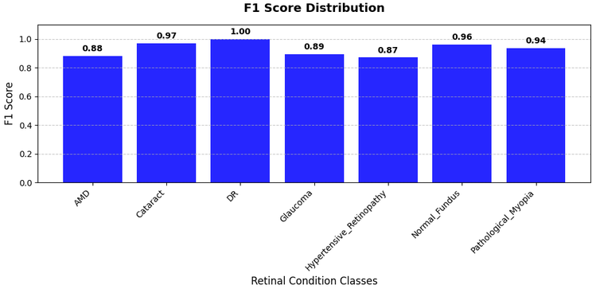

# Retinal Fundus Image Classifier
### A deep learning-based retinal fundus image classification system that classifies retinal images into 7 different disease categories. Achieved 95.55% test accuracy with balanced per class performance. The project provides an interactive Streamlit web application where users can upload a retinal image and receive a predicted disease.

## Metrics
Metrics:
- Accuracy: 0.9555
- Precision: 0.9580
- Recall: 0.9555
- F1 Score: 0.9554

## Classification Report
| Class | Precision | Recall | F1-Score | Support |
| :--- | :---: | :---: | :---: | :---: |
| **AMD** | 0.81 | 0.97 | 0.88 | 77 |
| **Cataract** | 0.95 | 0.99 | 0.97 | 112 |
| **DR (Diabetic Retinopathy)** | 1.00 | 1.00 | 1.00 | 516 |
| **Glaucoma** | 0.88 | 0.90 | 0.89 | 156 |
| **Hypertensive Retinopathy** | 0.97 | 0.79 | 0.87 | 94 |
| **Normal Fundus** | 0.97 | 0.95 | 0.96 | 179 |
| **Pathological Myopia** | 0.95 | 0.92 | 0.94 | 102 |
| **Accuracy / Total** | — | — | 0.96 | 1236 |
| **Macro Average** | 0.93 | 0.93 | 0.93 | 1236 |
| **Weighted Average** | 0.96 | 0.96 | 0.96 | 1236 |

## Tech Stack
- Python, Pytorch, Torchvision, ResNet18, Streamlit, Pillow, Numpy

## Features
- ResNet18-Based Classification — Uses a deep learning model based on ResNet18.
- 7-Class Disease Detection — Classifies retinal images into seven categories (AMD — Age-related Macular Degeneration, Cataract, DR — Diabetic Retinopathy, Glaucoma, Hypertensive Retinopathy ,Normal Fundus, Pathological Myopia)
- Image Upload — Supports JPG, JPEG, and PNG fundus images.
- Real-Time Inference — Generates predictions from uploaded images.
- Interactive Streamlit Dashboard — Browser-based interface.

## Screenshots
### Dashboard

### Confusion Matrix

### F1 Score distribution

## Future Improvements
- Add a step in the pipeline to reject non fundus images (eg right now a picture of a golden retriever is classified as cataract)
- Add more interactive UI and better side by side layout

## Dataset
https://www.kaggle.com/datasets/gautamrajiitk/retinal-fundus-image-50k